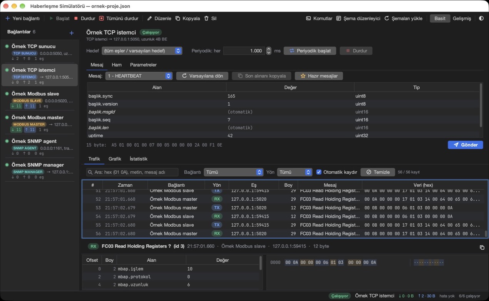

# CommSim

A desktop test tool for message-based communication protocols. Every connection can act as a
server or a client. Send messages by hand, watch traffic down to the byte, and script
repeatable tests: all without writing any code for a new message format.

Supported: **TCP**, **UDP** (unicast / broadcast / multicast), **Modbus TCP** (master and slave),
**SNMP** v1 / v2c / v3 (agent and manager), **WebSocket** (RFC 6455).

Java 8 compatible Swing application (bytecode level 52, verified on Java 8). Built with Maven.



## Features

- **Schema DSL for binary messages.** Define headers, footers, structs, enums, bit fields,
  length-prefixed and fixed-size strings, lists, and big/little endian per field in a plain text
  `.def` file. No recompilation: edit, press *Reload schemas*. A visual schema editor is included.
  See [`schemas/ornek.def`](schemas/ornek.def) for a commented example.
- **Auto fields.** Length, count and checksums (SUM8, XOR8, CRC16 Modbus, CRC16-CCITT, CRC32)
  are filled on encode and verified on decode.
- **Traffic inspector.** Decoded field table next to a colored hex + ASCII dump, field-to-byte
  highlighting, frame diff, response-time column, live charts of decoded fields and Modbus registers.
- **Scenarios.** A small scripting language (`send`, `expect`, `waitfor`, `repeat`, `while`,
  `function`, `include`) plus embedded Groovy for logic. Scenario editor has syntax coloring,
  context-aware completion and live error checking. Scenarios also run headless.
- **Auto-reply rules and value generators.** Reply to incoming frames by condition; drive fields
  and Modbus registers / SNMP OIDs with `counter`, `random`, `sine`, `ramp`, `toggle`, ...
- **Fault injection.** Per connection: drop, duplicate, corrupt checksum, shift length,
  flip random bytes, truncate, add delay and jitter.
- **Record and replay** traffic; export logs as CSV or text.
- **Projects.** Save and reopen the full setup (connections, schemas, scenario) as JSON.

## Build and run

Requires JDK 8 or newer and Maven.

```bash
mvn -q package                 # builds target/commsim.jar (all dependencies included, ~14 MB)
java -jar target/commsim.jar projects/ornek-proje.json
./commsim.sh                   # build + run in one step
./check-java8.sh               # run the tests and example scenarios on Java 8 (set JAVA8_HOME)
```

The tool opens with six example connections: a TCP server/client pair using
`schemas/ornek.def`, a Modbus slave/master pair, and an SNMP agent/manager pair.
Run the bundled scenario from the *Scenario* tab (`scenarios/ornek.scn`).

> The user interface and the sample files are currently in Turkish. The detailed user guide is
> [`docs/USER-GUIDE.tr.md`](docs/USER-GUIDE.tr.md). An English UI is not available yet.

## Tests

```bash
mvn test
```

80 tests cover the schema codec, framing, the Modbus and SNMP endpoints, the scenario engine,
the rule engine, project files and the script editor's completion logic.

## Project layout

| Path | Contents |
|---|---|
| `src/main/java/comm/schema` | Schema parser, codec, checksums |
| `src/main/java/comm/transport`, `modbus`, `snmp`, `ws` | Protocol endpoints |
| `src/main/java/comm/scenario`, `runtime` | Scenario runner, rules, generators, replay |
| `src/main/java/comm/ui` | Swing UI |
| `schemas/`, `scenarios/`, `projects/`, `oids/` | Examples |
| `src/sim`, `harita-lib/` | Older standalone map demo (OpenMap), not part of the Maven build; see [`docs/MAP-MODULE.md`](docs/MAP-MODULE.md) |

## Third-party

SNMP4J, Jackson, FlatLaf, Groovy, RSyntaxTextArea, JetBrains Mono, DejaVu Sans. The legacy map
demo bundles OpenMap (BBN license) and NASA Blue Marble imagery.
